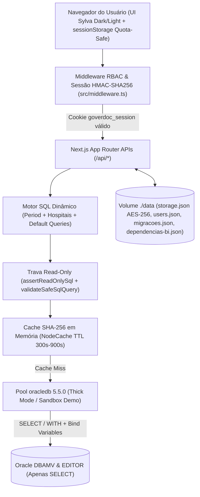

# Especificação Técnica — Goverdoc Pro

> Plataforma de **Governança de Documentos Clínicos** para ambientes hospitalares **MV** (**Editor 2.0 Flex / `DBAMV`** e **Editor 3.0 HTML5 / `EDITOR`**), construída em Next.js com execução SQL exclusivamente **Read-Only** sobre o banco Oracle.

---

## 1. Visão Arquitetural

O **Goverdoc Pro** opera como uma aplicação web standalone (Node.js + Next.js App Router) que se conecta diretamente ao banco Oracle do hospital via pool de conexões em **Thick Mode** (Oracle Instant Client) ou roda em **Modo Demonstração (Sandbox)** isolado com dados sintéticos para homologação e treinamento.

---

## 2. Stacks de Desenvolvimento e Dependências

Extraído diretamente de [`package.json`](../package.json):

### Core & Runtime
| Tecnologia | Versão | Função |
| :--- | :--- | :--- |
| **Next.js (App Router + Standalone Output)** | `16.1.7` | Framework Full-Stack SSR/CSR, rotas de API e empacotamento standalone Docker (`output: 'standalone'`) |
| **React / React DOM** | `19.2.3` | Interface reativa com React Compiler habilitado no lint |
| **TypeScript** | `^5` | Tipagem estrita end-to-end entre UI, APIs e camadas Oracle |
| **Node.js (Container Base)** | `20-bookworm-slim` | Runtime de servidor e execução nativa de scripts |

### Interface, Visualização de Grafos & Dados
| Biblioteca | Versão | Aplicação no Sistema |
| :--- | :--- | :--- |
| **Tailwind CSS** | `^4` (`@tailwindcss/postcss`) | Design System **Sylva Frosted Glass** (`Dark` & `Light` com CSS variables semânticas) |
| **Cytoscape.js** | `^3.35.0` | Renderização do **Mapa em Rede** no grafo de linhagem global |
| **ELKjs** | `^0.12.2` | Algoritmo de layout hierárquico ortogonal para grafos complexos no Cytoscape |
| **@xyflow/react** | `^12.12.0` | Fluxo visual em canvas interativo |
| **@dagrejs/dagre** | `^3.1.1` | Cálculo auxiliar de posicionamento de grafos direcionados |
| **D3** | `^7.9.0` | Cálculos visuais e escalas gráficas |
| **Recharts / Tremor** | `^3.8.1` / `^3.18.7` | Gráficos analíticos (Curva ABC, SLA, Turnos, Auditoria de Similaridade) |
| **Diff** | `^7.0.0` | Comparação visual texto-a-texto em auditoria de prontuários e versões |
| **XLSX (SheetJS)** | `^0.18.5` | Exportação e importação em planilhas Excel (Dependências BI, Auditoria, Catálogo) |
| **Lucide React** | `^0.577.0` | Iconografia unificada |
| **Headless UI / Radix UI** | `^2.2.10` / `^1.2.x` | Primitivos acessíveis (tooltips, slots, menus) |
| **React Hot Toast** | `^2.6.0` | Feedback instantâneo não bloqueante |

### Banco de Dados, Cache & Qualidade
| Tecnologia | Versão | Função |
| :--- | :--- | :--- |
| **node-oracledb** | `^5.5.0` | Driver Oracle configurado em `serverExternalPackages` com pool (`poolMin: 2`, `poolMax: 15`, `poolPingInterval: 1`) |
| **Oracle Instant Client Basic Light** | `23.x` | Obrigatório para **Thick Mode** (leitura confiável de `CLOB`/`DBMS_LOB` em regras e scripts SQL do MV) |
| **node-cache** | `^5.1.2` | Cache em memória de respostas SQL indexado por hash `SHA-256` da query completa |
| **ESLint (`eslint-config-next`)** | `^9` / `16.1.7` | Análise estática e regras React Hooks / TypeScript |

---

## 3. Segurança, Autenticação e Governança Read-Only

O Goverdoc Pro foi projetado para operar em redes hospitalares sob requisitos rígidos de conformidade (LGPD e auditoria assistencial):

1. **Política Estrita Read-Only (`src/lib/oracle.ts` e `src/app/api/oracle/execute/route.ts`)**
   - `assertReadOnlySql()` remove comentários e literais e rejeita qualquer comando que não inicie com `SELECT` ou `WITH`, além de bloquear palavras-chave DDL/DML (`INSERT`, `UPDATE`, `DELETE`, `DROP`, `ALTER`, `TRUNCATE`, `GRANT`, `REVOKE`, `MERGE`, `CREATE`).
   - `validateSafeSqlQuery()` adiciona proteção extra em consultas dinâmicas submetidas à API `/api/oracle/execute`, bloqueando múltiplos statements (`;`), `EXEC`/`CALL`/`DECLARE`/`BEGIN` e acesso a objetos administrativos Oracle (`SYS.`, `SYSTEM.`, `DBA_*`, `V$*`, `GV$*`, `ALL_USERS`, `UTL_*`, `DBMS_SCHEDULER`, `DBMS_SQL`).
   - Consultas parametrizadas utilizam **Bind Variables nomeadas** (`:CD_DOCUMENTO`, `:ID`, `:CD_PERFIL`, `:DATA_INI`, `:DATA_FIM`) prevenindo SQL Injection.

2. **Criptografia de Credenciais em Repouso (`src/lib/encryption.ts`)**
   - Senhas das conexões Oracle salvas em `data/storage.json` são criptografadas com **AES-256-CBC** (IV aleatório de 16 bytes por registro, prefixo `encrypted:`).
   - A chave é carregada em ordem de prioridade: variável de ambiente `ENCRYPTION_KEY` (recomendada em produção), arquivo protegido `data/.encryption_key` (`0600`), fallback `.env`.

3. **Sessão & RBAC (`src/lib/session.ts` e `src/middleware.ts`)**
   - Cookie HTTP `goverdoc_session` assinado via **HMAC-SHA256** (Web Crypto API compatível com Edge Runtime), validade de **24 horas**.
   - Perfis de acesso:
     - **`ADMIN`**: acesso completo a todos os módulos e à **Central de Configurações** (`/configuracoes`), rotas `/api/users` e mutações em `/api/connections`.
     - **`ANALISTA`**: acesso completo aos painéis analíticos e operacionais; redirecionado ao `/dashboard` se tentar acessar `/configuracoes/*` e bloqueado (`HTTP 403`) em rotas administrativas.

4. **Cabeçalhos de Segurança HTTP (`next.config.ts`)**
   - `X-Frame-Options: DENY`
   - `X-Content-Type-Options: nosniff`
   - `Referrer-Policy: strict-origin-when-cross-origin`
   - `Permissions-Policy: camera=(), microphone=(), geolocation=()`

---

## 4. Motor Dinâmico de Consultas SQL e Macros

Todas as consultas padrão residem em [`src/lib/default-queries.ts`](../src/lib/default-queries.ts) e podem ser personalizadas por hospital na Central de Configurações (`/configuracoes`). O motor substitui macros em tempo de execução antes de gerar a chave de cache e consultar o Oracle:

| Macro | Função | Origem do Valor |
| :--- | :--- | :--- |
| `/* DYNAMIC_PERIOD_DAYS */` | Define a janela de análise em dias ou converte para faixa `TO_DATE` fechada | Seletor global da UI (`30d`, `60d`, `90d`, `180d`, `365d` ou intervalo `Data Inicial → Data Final` até 365 dias) |
| `/* DYNAMIC_HOSPITALS_IN */` | Injeta lista de IDs `CD_MULTI_EMPRESA` ativos | Aba `Instituições (MV)` em `/configuracoes?tab=instituicoes` |
| `/* DYNAMIC_HOSPITALS_PIVOT */` | Gera colunas dinâmicas `MAX(CASE WHEN CD_MULTI_EMPRESA = ...)` por sigla de unidade | Aba `Instituições (MV)` |
| `/* DYNAMIC_HOSPITALS_DECODE(col) */` | Gera expressão `Decode(col, id1, 'SIGLA1', ...)` para exibir siglas amigáveis | Aba `Instituições (MV)` |

### Regra de Janelas Dinâmicas vs. Operacionais Fixas
- **Consultas com Período Selecionável**: Catálogo de Documentos, Volume Geral, Taxa de Assinatura, Curva ABC (Top 10), Documentos Ociosos, Adesão por Unidade, Inatividade por Unidade e KPIs/Detalhamento de Hospitais. Padrão ao abrir a página: **`30d`** (limitação máxima de **`365 dias`** em intervalos personalizados).
- **Consultas com Janela Fixa Preservada**:
  - **Produção Recente**: sempre `SYSDATE - 1` (24 horas).
  - **Dinâmica de Turnos (Dia/Noite)**: sempre `TRUNC(SYSDATE) - 7` (últimos 7 dias).
  - **SLA de Assinatura**: sempre `TRUNC(SYSDATE) - 30` (últimos 30 dias).

---

## 5. Cache Multinível e Resiliência

- **Backend (`src/lib/cache.ts`)**: `NodeCache` compartilhado (`stdTTL: 600s`). `generateCacheKey()` aplica **SHA-256 sobre a query SQL completa** + `connectionId` + `binds`, eliminando colisões entre períodos com a mesma contagem de caracteres (`30d`/`60d`/`90d` ou `180d`/`365d`). Ao salvar alterações em queries ou empresas, `clearQueryCache()` limpa tanto `queryCache` quanto `dashboardCache`.
- **Frontend (`src/lib/safe-storage.ts` e `UIContext`)**: `safeSessionSetItem()` realiza evicção automática de chaves antigas caso o `sessionStorage` do navegador atinja a cota de ~5 MB em catálogos muito grandes (> 600 documentos com dezenas de empresas), evitando exceções `QuotaExceededError`.

---

## 6. Dicionário de Tabelas Oracle Consultadas (Schemas `DBAMV` e `EDITOR`)

### Schema `DBAMV` (Comum + Editor 2.0 Flex + Perfis)
- `DBAMV.MULTI_EMPRESAS`
- `DBAMV.PW_DOCUMENTO_CLINICO`
- `DBAMV.PW_EDITOR_CLINICO`
- `DBAMV.ATENDIME`
- `DBAMV.PRESTADOR`
- `DBAMV.EDITOR_DOCUMENTO`
- `DBAMV.EDITOR_VERSAO_DOCUMENTO`
- `DBAMV.EDITOR_TIPO_VERSAO`
- `DBAMV.EDITOR_LAYOUT`
- `DBAMV.EDITOR_TIPO_LAYOUT`
- `DBAMV.EDITOR_LAYOUT_CAMPO`
- `DBAMV.EDITOR_CAMPO`
- `DBAMV.EDITOR_TIPO_VISUALIZACAO`
- `DBAMV.EDITOR_CAMPO_PROP_VAL`
- `DBAMV.EDITOR_LAYOUT_REGRA`
- `DBAMV.EDITOR_REGRA`
- `DBAMV.EDITOR_TIPO_REGRA`
- `DBAMV.EDITOR_REGRA_CONDICAO`
- `DBAMV.EDITOR_TIPO_CONECTOR`
- `DBAMV.EDITOR_TIPO_OPERACAO`
- `DBAMV.EDITOR_REGRA_CAMPO`
- `DBAMV.PERFIL_AMBULATORIAL`, `DBAMV.PERFIL_AMBULATORIAL_EMPRESA`, `DBAMV.PERFIL_AMBULATORIAL_TIP_PREST`
- `DBAMV.PW_PERFIL_MODULO`, `DBAMV.PW_PERFIL_MODULO_PARAMETRO`
- `DBAMV.PW_TIPO_DOCUMENTO_CONSULTA`, `DBAMV.PW_TIPO_DOCUMENTO_MODULO`, `DBAMV.PW_TIPO_DOCUMENTO_MODULO_PARAM`
- `DBAMV.PAGU_OBJETO`, `DBAMV.ESPECIALID`, `DBAMV.TIP_PRESTA`, `DBAMV.SETOR`
- `<OWNER>.TB_AUDITORIA_SIMILARIDADE` e `<OWNER>.V_AUDITORIA_COPIA_COLA` *(objetos opcionais do módulo de auditoria NLP de similaridade; o schema/owner é configurável em `Configurações > Parâmetros`, padrão `DBAMV`, com fallback automático via leitura direta em `DBAMV.PW_DOCUMENTO_CLINICO` + `EDITOR.EDITOR_REGISTRO_CAMPO` no Editor 3.0 V3 ou `DBAMV.EDITOR_REGISTRO_CAMPO` no Editor 2.0 V2 caso a view ainda não exista)*

### Schema `EDITOR` (Editor 3.0 HTML5)
- `EDITOR.EDITOR_DOCUMENTO`
- `EDITOR.EDITOR_VERSAO_DOCUMENTO`
- `EDITOR.EDITOR_LAYOUT`
- `EDITOR.EDITOR_TIPO_LAYOUT`
- `EDITOR.EDITOR_LAYOUT_CAMPO`
- `EDITOR.EDITOR_CAMPO`
- `EDITOR.EDITOR_TIPO_VISUALIZACAO`
- `EDITOR.EDITOR_CAMPO_PROP_VAL`
- `EDITOR.EDITOR_REGISTRO_CAMPO` *(leitura de conteúdo clínico para Auditoria de Similaridade V3 e comparação lado a lado)*
- `EDITOR.EDITOR_REGRA`
- `EDITOR.EDITOR_TIPO_REGRA`
- `EDITOR.EDITOR_REGRA_CONDICAO`
- `EDITOR.EDITOR_REGRA_CONECTOR`
- `EDITOR.EDITOR_REGRA_OPERADOR`
- `EDITOR.EDITOR_REGRA_CAMPO`
- `EDITOR.EDITOR_REGRA_PROP_VAL`

---

## 7. Catálogo de Rotas de API (`src/app/api`)

| Rota | Métodos | Finalidade |
| :--- | :--- | :--- |
| `/api/auth/connect`, `/session`, `/disconnect` | `GET`, `POST` | Login RBAC, inspeção de sessão ativa e logout |
| `/api/connections` | `GET`, `POST` | Gestão de instâncias Oracle, queries V2/V3, hospitais, URL Report Web e parâmetros |
| `/api/users` | `GET`, `POST`, `PUT`, `DELETE` | CRUD de usuários locais (exclusivo `ADMIN`) |
| `/api/oracle/execute` | `POST` | Execução Read-Only para Catálogo, Perfis, Metadados, Regras, Campos (`DOC_FIELDS`), Ações, Busca de Similaridade (`SIMILARIDADE`), Comparação Lado a Lado (`SIMILARITY_COMPARE`) e Teste de Conexão |
| `/api/oracle/health` | `GET` | Healthcheck da conexão Oracle ativa e do pool |
| `/api/oracle/lineage` | `GET` | Extração e resolução de grafo completo de dependências SQL (Ações + Regras) |
| `/api/dashboard/stats`, `/analytics`, `/quality`, `/custom` | `GET`, `POST` | KPIs executivos, Curva ABC, ociosidade, turnos, SLA e cards personalizados |
| `/api/hospitals/stats`, `/quality` | `GET` | Métricas detalhadas, top 5 e SLA segmentados por `CD_MULTI_EMPRESA` |
| `/api/empresas` | `GET` | Listagem de `DBAMV.MULTI_EMPRESAS` no banco ativo |
| `/api/documentos/compare` | `GET` | Comparação estrutural de layouts/campos/regras entre versões V2 e V3 |
| `/api/migracao` | `GET`, `POST`, `PUT`, `DELETE` | Kanban e rastreamento de migração Editor 2.0 → 3.0 |
| `/api/dependencias-bi` | `GET`, `POST`, `PUT`, `DELETE` | Inventário de impacto de documentos em painéis BI (Power BI, Metabase, Oracle Views, etc.) |
| `/api/ai/ollama` | `POST` | Integração opcional com Ollama local para sugestão e otimização de SQL Oracle |
| `/api/scripts` | `POST` | Motor nativo Node.js de auditoria NLP de similaridade (Ratcliff/Obershelp) com streaming de logs e gravação em `<OWNER>.TB_AUDITORIA_SIMILARIDADE` |
